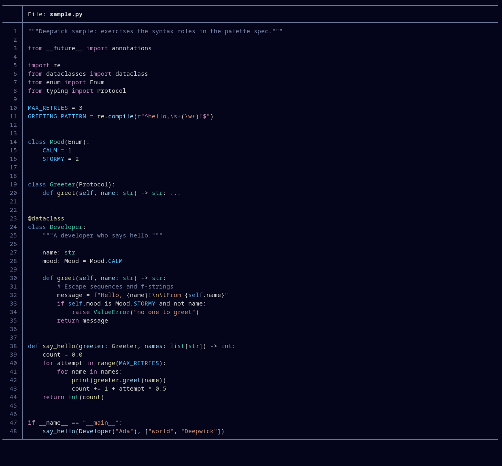

# Deepwick for bat and delta

A deep navy syntax theme with Visual Studio 2022's colors, for
[bat](https://github.com/sharkdp/bat) and
[delta](https://github.com/dandavison/delta).

> Deepwick is an unofficial theme derived from
> [Polywick Blue](https://vscode.polywickstudio.net) by Polywick Studio (MIT).
> Not affiliated with Polywick Studio.



## bat

```sh
mkdir -p "$(bat --config-dir)/themes"
cp Deepwick.tmTheme "$(bat --config-dir)/themes/"
bat cache --build
bat --theme=Deepwick some-file.py
```

To make it the default, add `--theme="Deepwick"` to `$(bat --config-file)`
or set `BAT_THEME=Deepwick`. bat draws italics only when asked, so add
`--italic-text=always` to the same file to get italic comments.

## delta

delta has no theme directory of its own: it loads bat's built cache from
`~/.cache/bat` (or `$XDG_CACHE_HOME/bat`), and ignores `BAT_CACHE_PATH`. So
install the bat theme and run `bat cache --build` first. Then add to
your `~/.gitconfig`:

```ini
[include]
    path = /path/to/deepwick.gitconfig
[delta]
    features = deepwick
```

Added and removed lines get dim green and red backgrounds, with stronger
backgrounds on the changed words.

## Notes

- `variable.language` (Python `self`, JavaScript `this`) is Blue, matching
  Visual Studio's keyword color.
- Diff file headers and hunk ranges are Blue.
- Python decorators (`@dataclass`) are Yellow, like functions.

Tested with bat 0.26.1 and delta 0.19.2.

## License

MIT. See [LICENSE](LICENSE).
